### `~/projects`

<table>
<tr>
<td width="50%"></td>
<td width="50%"></td>
</tr>
<tr>
<td width="50%"></td>
<td width="50%"></td>
</tr>
<tr>
<td width="50%"></td>
<td width="50%"></td>
</tr>
</table>

### `~/stack`

### `~/stats`

### `~/activity`

Cards in this profile are rendered from this repository and refreshed every 6 hours by GitHub Actions.

